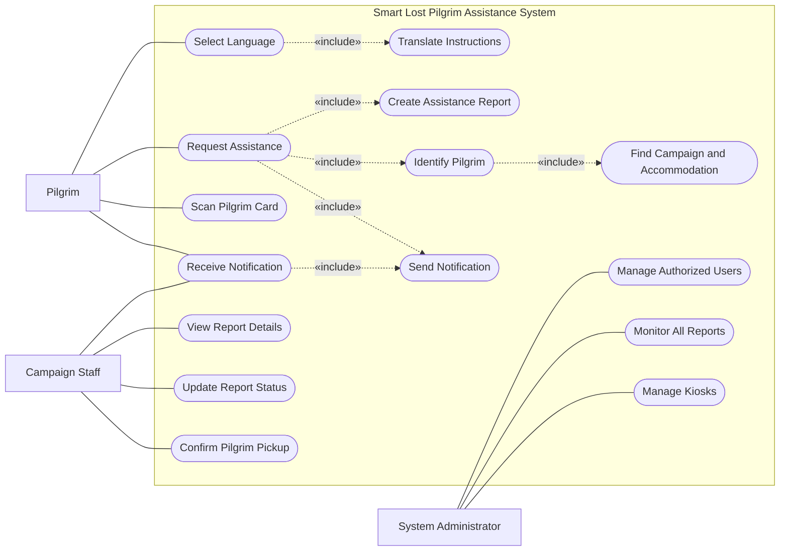

<div align="center">
  
  <h1>ONS — Lost Pilgrims Assistance System</h1>
  <p>A digital assistance platform to help identify lost pilgrims and coordinate support with their campaigns.</p>
</div>

## Deployment

[Open the deployed ONS application](https://d3ujyxwecja6r4.cloudfront.net/)

The ONS application is deployed on AWS. The frontend is maintained in a separate repository from the Spring Boot backend.

- **Frontend repository:** [ONS-Frontend](https://github.com/ThekraMahmoud/ONS-Frontend)
- **Backend / main project repository:** [ONS-FinalProject](https://github.com/faisalbageis/ONS-FinalProject)

## Overview

ONS brings pilgrim identification and assistance workflows together for campaign teams. A pilgrim can request help through an interactive kiosk; the system records the request and kiosk location so the relevant team can coordinate a response.

This README documents the ONS frontend and the frontend-related work, alongside the system overview and diagrams from the main project README.

## Frontend capabilities

- Provide user-facing interfaces for ONS pilgrim assistance and campaign operations.
- Integrate kiosk information, device status, and device location into the frontend.
- Display Haramain location information through an interactive map built with Leaflet and React Leaflet.
- Connect frontend views to backend APIs for kiosk information, activity, reports, and campaign analytics.
- Support clear, consistent screens and responsive layouts for operational workflows.

## System diagrams

### Use case diagram



### Class diagram


## Technologies and integrations

### Frontend

- React
- Vite
- JavaScript
- Leaflet and React Leaflet for interactive mapping
- Axios for backend API integration
- Backend API prefix: `/api/v1`

### System technologies

- Java 17 and Spring Boot
- Spring Web MVC, Spring Data JPA, Spring Security, and Bean Validation
- MySQL and Maven
- AWS deployment
- External integrations configured for OCR/QR processing, Google Maps, n8n notifications, email, and Moyasar payments

## Running locally

1. Clone the frontend repository:

   ```bash
   git clone https://github.com/ThekraMahmoud/ONS-Frontend.git
   cd ONS-Frontend
   ```

2. Install dependencies:

   ```bash
   npm install
   ```

3. Start the development server:

   ```bash
   npm run dev
   ```

Configure the backend API connection and any environment variables according to the current project configuration.

> Never commit passwords, API keys, access tokens, or other secrets to GitHub.

## Team

- **Danah Alsahli** — [@DanahAlsahli](https://github.com/DanahAlsahli)
- **Thekra Mahmoud** — [@ThekraMahmoud](https://github.com/ThekraMahmoud)
- **Faisal Bageis** — [@faisalbageis](https://github.com/faisalbageis)

## Thekra Mahmoud's contribution

My contribution focuses on frontend development and the kiosk and campaign workflows I worked on within ONS.

### Frontend development and interactive map

- Developed ONS frontend interfaces using React and Vite.
- Worked on the Haramain interactive map using Leaflet and React Leaflet.
- Integrated kiosk data into the frontend, including device locations and statuses.
- Connected frontend screens with backend APIs for kiosk information, activity, reports, and campaign analytics.
- Worked on a consistent user interface and UI/UX direction inspired by Islamic art and architecture, including geometric motifs, architectural arches, and a coordinated emerald-green, ivory, and gold palette.

### Kiosk management and monitoring endpoints

- `PATCH /api/v1/kiosks/update-status/{id}` — Update kiosk status.
- `PATCH /api/v1/kiosks/update-location/{kioskId}` — Update kiosk location.
- `PATCH /api/v1/kiosks/heartbeat/all` — Update heartbeat signals for kiosks.
- `GET /api/v1/kiosks/{kioskId}/reports` — Retrieve reports associated with a kiosk.
- `GET /api/v1/kiosks/activity` — Retrieve kiosk activity data.
- `GET /api/v1/kiosks/report/{adminId}` — Retrieve the kiosk report associated with an admin ID.

### Campaign analytics endpoints

- `GET /api/v1/campaigns/analytics` — Retrieve campaign analytics.
- `POST /api/v1/campaigns/analytics/email` — Send a campaign analytics report by email.

### Additional workflows

- Assistance requests initiated through kiosks and reports generated from kiosk interactions.
- Case receipt and handover confirmation, final delivery confirmation, and handover history.
- Campaign announcements and campaign/device usage analytics.
- Administrative service automation and assistance with report-status workflows.

See my [GitHub profile](https://github.com/ThekraMahmoud).
