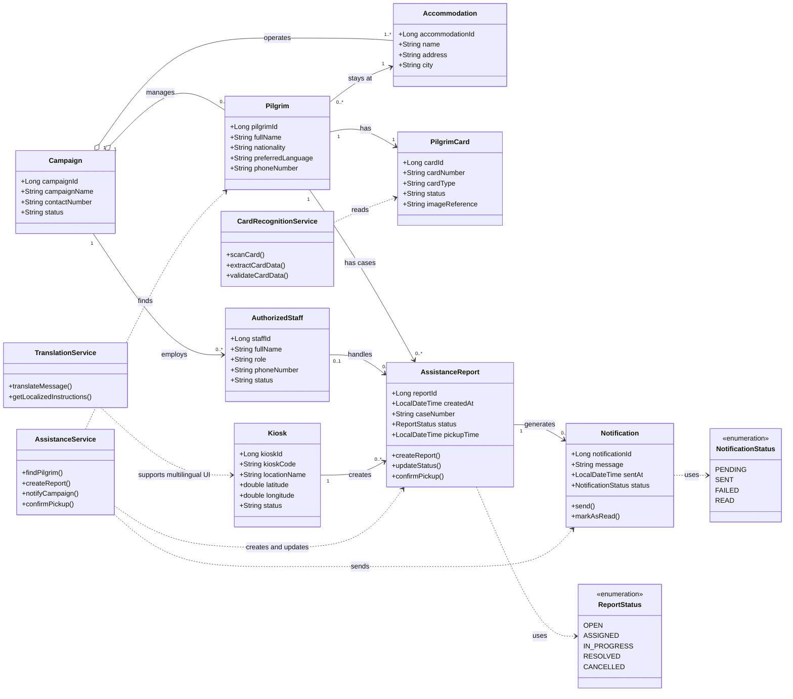

[README1.md](https://github.com/user-attachments/files/34053312/README1.md)
<div align="center">
  
  <h1>ONS — Lost Pilgrims Assistance System</h1>
  <p>A digital assistance platform to help identify lost pilgrims and coordinate support with their campaigns.</p>
</div>

## Deployment

[Open the deployed ONS application](https://d3ujyxwecja6r4.cloudfront.net/)

The application is deployed on AWS, where the React web interface and Spring Boot backend are served together. It provides screens for pilgrim assistance and campaign operations, including reports, kiosks, accommodations, and analytics. Some workflows are still being validated against the backend.

## Overview

ONS brings pilgrim identification and assistance workflows together for campaign teams. A pilgrim can request help through an interactive kiosk; the system records the request and kiosk location so the relevant team can coordinate a response.

This repository contains the Spring Boot backend. The frontend is maintained separately.

## Backend capabilities

- Manage pilgrims, pilgrim cards, campaigns, accommodations, kiosks, and staff.
- Identify pilgrims using card information or OCR. OCR processing is delegated to a separate AI service.
- Create and process assistance reports, including assignment, reassignment, status changes, and report history.
- Send notifications through configured email and automation integrations.
- View campaign dashboards and analytics, and access kiosk and map-related services.
- Support campaign registration and payment workflows through Moyasar.

## System diagrams

### Use case diagram


### Class diagram



## Technologies and integrations

- Java 17 and Spring Boot 4.1.1
- Spring Web MVC, Spring Data JPA, Spring Security, and Bean Validation
- MySQL and Maven
- AWS for deployment
- External integrations configured for OCR/QR processing, Google Maps, n8n notifications, email, and Moyasar payments

## Running locally

1. Install Java 17 or newer and MySQL.
2. Create a MySQL database named `ons`, or update the datasource settings in `src/main/resources/application.properties`.
3. Configure the integration environment variables referenced in `application.properties`: `N8N_EMAIL_WEBHOOK_URL`, `N8N_WHATSAPP_WEBHOOK_URL`, `GOOGLE_MAPS_API_KEY`, `MOYASAR_SECRET_KEY`, `MAIL_USERNAME`, and `MAIL_PASSWORD`.
4. If using OCR, start the separate AI service and set `ons.ai.base-url` to its address. The default is `http://localhost:8000`.
5. Start the backend:

   ```bash
   ./mvnw spring-boot:run
   ```

The API uses the `/api/v1` prefix for most resources. For the Postman collection and its setup notes, see [`postman/README.md`](postman/README.md).

## Team

- **Danah Alsahli** — [@DanahAlsahli](https://github.com/DanahAlsahli)
- **Thekra Mahmoud** — [@ThekraMahmoud](https://github.com/ThekraMahmoud)
- **Faisal Bageis** — [@faisalbageis](https://github.com/faisalbageis)

## Faisal's contribution

My contribution included API documentation for account management, notifications, maps and navigation, roles and permissions, background jobs, and advanced assistance-report workflows. 

### Account management

- `GET /api/v1/auth/get/all`
- `GET /api/v1/auth/get/{id}`
- `PUT /api/v1/auth/activate/{id}`
- `PUT /api/v1/auth/deactivate/{id}`
- `POST /api/v1/auth/change-password/{id}`

### Notifications

- `POST /notification/add`
- `GET /notification/get`
- `GET /notification/get/{id}`
- `PUT /notification/update/{id}`
- `DELETE /notification/delete/{id}`

### Maps and routes

- `GET /api/v1/map/markers`
- `GET /api/v1/map/nearest-kiosk`
- `POST /api/v1/map/route`
- `GET /api/v1/map/kiosks/{kioskId}/nearest-place`
- `GET /api/v1/routes`

### Advanced assistance-report workflows

- `POST /api/v1/reports/{reportId}/merge`
- `GET /api/v1/reports/overdue`
- `GET /api/v1/reports/campaign/{campaignId}/overdue`
- `GET /api/v1/field-staff/availability`

See my [GitHub profile](https://github.com/faisalbageis).
